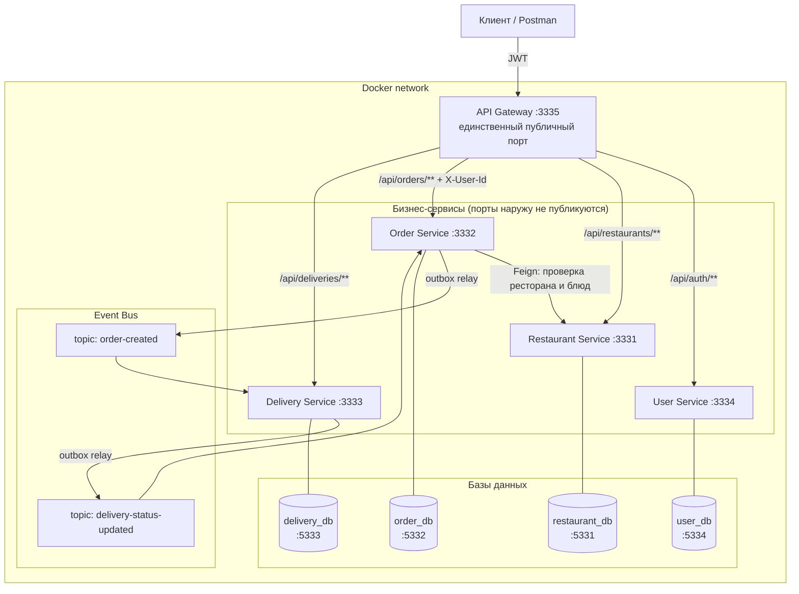

# DeliveryHub — микросервисная платформа доставки еды

<div align="center">


</div>

Пять сервисов, у каждого своя БД. Синхронное взаимодействие — через Feign,
асинхронное — через Kafka. Единственная публичная точка входа — API Gateway.
Сервисы находят друг друга через Eureka, а настройки окружения получают из Config Server.

## Как это работает

1. Пользователь регистрируется и логинится в **User Service**, получает пару токенов: короткий
   access-токен (JWT, RS256, 15 минут) и непрозрачный refresh-токен (30 дней).
   В access-токене лежат `sub` (email), `uid` (id пользователя) и `role`.
2. **API Gateway** проверяет подпись токена публичным ключом, который берёт у User Service
   (`/.well-known/jwks.json`), и пробрасывает личность вниз заголовками
   `X-User-Id` / `X-User-Email` / `X-User-Role`. Входящие заголовки
   `X-User-*` от клиента всегда затираются — подделать их нельзя.
3. Каталог ресторанов и меню читается из **Restaurant Service** без токена;
   изменять каталог может только `ADMIN`.
4. **Order Service** создаёт заказ. `userId` берётся из токена, а не из тела запроса.
   Ресторан и каждая позиция меню проверяются по HTTP (Feign) — в том числе то,
   что блюдо принадлежит именно этому ресторану.
5. Вместе с заказом в той же транзакции сохраняется `OrderCreatedEvent` (outbox), relay публикует его в Kafka.
6. **Delivery Service** читает событие, идемпотентно создаёт доставку и публикует
   `DeliveryStatusUpdatedEvent` — как при автосоздании, так и при ручной смене статуса.
7. **Order Service** переводит заказ в свой статус (`ASSIGNED` доставки → `CONFIRMED` заказа).

## Архитектура



## Технологический стек

| Категория            | Технологии                                     |
|:---------------------|:-----------------------------------------------|
| **Язык**             | Java 25                                        |
| **Фреймворк**        | Spring Boot 4.0.7                              |
| **Микросервисы**     | Spring Cloud Gateway, OpenFeign, Eureka, Config|
| **Отказоустойчивость**| Resilience4j: circuit breaker, retry, timeout |
| **Асинхронность**    | Kafka 4.1 (KRaft), outbox + inbox, DLT         |
| **Контракты событий**| Avro 1.12, Confluent Schema Registry 8.1       |
| **Базы данных**      | PostgreSQL 17, по одной на сервис              |
| **Миграции**         | Flyway (`ddl-auto: validate`)                  |
| **Безопасность**     | Spring Security, JWT RS256 + JWKS, refresh-токены |
| **Rate limiting**    | Redis 8 + RequestRateLimiter на гейтвее        |
| **Документация**     | SpringDoc OpenAPI, агрегация на гейтвее        |
| **Тесты**            | JUnit + Mockito + AssertJ, Testcontainers      |
| **Наблюдаемость**    | Micrometer + Prometheus, JSON-логи, Loki + Alloy, Grafana |
| **Сборка**           | Gradle 9.6 (Kotlin DSL), общий каталог версий  |

## Быстрый старт

```bash
git clone https://github.com/nmaksimka/Delivery-Hub.git
cd Delivery-Hub
cp .env.example .env      # обязательно: задайте пароли eureka / config / grafana
docker compose up --build
```

`JWT_PRIVATE_KEY` можно не задавать: тогда User Service при старте сгенерирует временный RSA-ключ,
и после перезапуска все выданные токены перестанут приниматься. Постоянный ключ (PKCS#8, одной строкой):

```bash
openssl genpkey -algorithm RSA -pkeyopt rsa_keygen_bits:2048 -outform DER | base64 -w0
```

Kafka работает в режиме KRaft одним узлом, ZooKeeper не нужен. Если остались тома от прошлой версии
с PostgreSQL 16, их нужно пересоздать: `docker compose down -v`.

### Доступные адреса

| Что                      | Адрес                                  |
|:-------------------------|:---------------------------------------|
| API Gateway              | http://localhost:3335                  |
| Swagger UI (все сервисы) | http://localhost:3335/swagger-ui.html  |
| Prometheus               | http://localhost:9090                  |
| Grafana                  | http://localhost:3000                  |
| Eureka (список сервисов) | http://localhost:8761                  |
| Config Server            | http://localhost:8888/orderService/docker |
| Kafka UI                 | http://localhost:8086                  |
| Schema Registry          | http://localhost:8085                  |
| PostgreSQL (order)       | localhost:5332                         |

Порты 3331–3334 наружу не публикуются: обращаться к сервисам напрямую в обход
авторизации гейтвея нельзя. Наружу (на все интерфейсы) смотрит только гейтвей; Prometheus, Grafana,
Kafka UI, Schema Registry, Kafka и служебные серверы привязаны к `127.0.0.1`.

Порты баз данных вынесены в `docker-compose.override.yml`: Docker Compose подхватывает его сам,
так что локально базы доступны на `127.0.0.1:5331–5334`. На сервере достаточно запускать
`docker compose -f docker-compose.yml up -d` — без этого файла базы наружу не публикуются вовсе.

> Схему держит Flyway, а Hibernate работает в режиме `validate`. Если вы
> поднимали проект на старых миграциях, пересоздайте тома:
> `docker compose down -v`.

## Примеры запросов

### 1. Регистрация

```http
POST http://localhost:3335/api/auth/register
Content-Type: application/json

{
  "email": "test@example.com",
  "password": "secret123",
  "name": "Test User",
  "phone": "+79991234567"
}
```

### 2. Логин

```http
POST http://localhost:3335/api/auth/login
Content-Type: application/json

{
  "email": "test@example.com",
  "password": "secret123"
}
```

Ответ содержит `accessToken` — его подставляем в заголовок `Authorization` — и `refreshToken`.

### 2.1. Обновление токенов и выход

```http
POST http://localhost:3335/api/auth/refresh
Content-Type: application/json

{ "refreshToken": "<refreshToken>" }
```

В ответ приходит новая пара, старый refresh-токен больше не действует.
`POST /api/auth/logout` с тем же телом отзывает refresh-токен (ответ `204`).

### 3. Создание заказа

```http
POST http://localhost:3335/api/orders
Content-Type: application/json
Authorization: Bearer <accessToken>

{
  "restaurantId": 1,
  "orderItemsRequest": [
    { "menuItemId": 1, "quantity": 2 }
  ]
}
```

`userId` в теле нет — сервис берёт его из токена.

### 4. Свои заказы

```http
GET http://localhost:3335/api/orders?page=0&size=20
Authorization: Bearer <accessToken>
```

### 5. Смена статуса доставки (ADMIN / COURIER)

```http
PATCH http://localhost:3335/api/deliveries/1/status
Content-Type: application/json
Authorization: Bearer <accessToken>

{ "status": "PICKED_UP" }
```

Заказ получит событие и перейдёт в `IN_DELIVERY`. Статус меняется только на один шаг:
из `ASSIGNED` сразу в `DELIVERED` перейти нельзя (`409`). Курьера можно назначить и без смены статуса:
`{ "courierId": 5 }`.

### 6. Отмена своего заказа

```http
POST http://localhost:3335/api/orders/1/cancel
Authorization: Bearer <accessToken>
```

Владелец может отменить заказ, пока тот `CREATED` или `CONFIRMED`; администратор — любой незавершённый.
В Kafka уходит `order-cancelled`, доставка отменяется по этому событию.

## Модель доступа

| Эндпоинт                        | Кто может                |
|:--------------------------------|:-------------------------|
| `POST /api/auth/**`             | все                      |
| `GET /.well-known/jwks.json`    | только внутри сети (гейтвей) |
| `GET /api/restaurants/**`       | все                      |
| `POST/PUT/DELETE /api/restaurants/**` | `ADMIN`            |
| `POST /api/orders`              | любой авторизованный     |
| `GET /api/orders`               | свои заказы              |
| `GET /api/orders/{id}`          | владелец или `ADMIN`     |
| `GET /api/orders/all`           | `ADMIN`                  |
| `POST /api/orders/{id}/cancel`  | владелец (до передачи курьеру) или `ADMIN` |
| `PATCH /api/orders/*/status`    | `ADMIN`, `COURIER`       |
| `GET /api/deliveries`           | `ADMIN`, `COURIER`       |
| `GET /api/deliveries/{id}`, `/order/{orderId}` | владелец заказа, `ADMIN`, `COURIER` |
| `POST /api/deliveries`, `PATCH /api/deliveries/*/status` | `ADMIN`, `COURIER` |

Гейтвей отвечает на `401` и `403` телом `application/problem+json`. Правила проверяются тестом
матрицы ролей (`GatewaySecurityIT.roleMatrix`).

## Аутентификация

- **Access-токен** — JWT, подписанный закрытым RSA-ключом User Service (RS256), живёт 15 минут.
  Общего секрета между сервисами больше нет: гейтвей — обычный OAuth2 resource server, он скачивает
  публичный ключ по JWKS и кеширует его; закрытый ключ не покидает User Service.
  Проверяются подпись, срок действия, издатель (`iss`) и алгоритм — токен с `HS256` не пройдёт.
- **Refresh-токен** — 32 случайных байта. В таблице `refresh_tokens` хранится только SHA-256 от него,
  так что утечка базы не даёт готовых токенов.
- **Ротация**: `/api/auth/refresh` отзывает предъявленный токен и выдаёт новый, старый запоминает
  преемника (`replaced_by`).
- **Повторное использование**: если предъявлен уже отозванный токен, значит, его копия у кого-то ещё.
  Сервис отзывает всю цепочку преемников, и обоим — и владельцу, и вору — придётся логиниться заново.
  Сессии на других устройствах (другие цепочки) не затрагиваются.
- `/api/auth/logout` отзывает refresh-токен; access-токен доживает свои минуты, поэтому он короткий.
- На `/api/auth/**` гейтвей не смотрит на заголовок `Authorization`: просроченный access-токен
  не мешает обновить пару.

## Ограничение частоты запросов

Гейтвей считает запросы в Redis (`RequestRateLimiter`, алгоритм token bucket):

| Что ограничивается       | Ключ                                   | Лимит по умолчанию            |
|:-------------------------|:---------------------------------------|:------------------------------|
| любой маршрут            | `uid` из токена, для анонимов — IP     | 20 запросов/с, всплеск до 40  |
| `POST /api/auth/login`   | IP                                     | 1 попытка/с, всплеск до 5     |

Сверх лимита гейтвей отвечает `429` в формате `ProblemDetail` с заголовком `Retry-After`; до сервисов
такой запрос не доходит. Лимиты задаются в `app.rate-limit.*` (`config-repo/apiGateway.yml`).
Если Redis недоступен, запросы пропускаются: лимит — защита от перебора и шума, а не причина лечь всем API.

## Статусы

- **Заказ**: `CREATED` → `CONFIRMED` → `IN_DELIVERY` → `DELIVERED` / `CANCELLED`
- **Доставка**: `ASSIGNED` → `PICKED_UP` → `IN_TRANSIT` → `DELIVERED` / `CANCELLED`

Это разные словари: статус доставки не записывается в заказ напрямую,
а транслируется через `OrderStatusResolver`.

Через API статус двигается строго на один шаг (или в `CANCELLED`), перескоки отклоняются с `409`.
Заказ, который следует за событиями доставки, может догонять её вперёд, но назад не откатывается.
Одновременные изменения одной записи ловит `@Version`: проигравший запрос получает `409`,
а обработчик Kafka просто повторяет попытку.

## Надёжная доставка событий

События не отправляются в Kafka напрямую из бизнес-кода. Сервис в одной транзакции сохраняет изменение
и строку в `outbox_events`, а `OutboxRelay` по расписанию забирает неотправленные строки
(`FOR UPDATE SKIP LOCKED`), публикует их и проставляет `published_at`. Потребитель запоминает `eventId`
в `processed_events` и повторно пришедшее событие пропускает. Подробности и компромиссы —
в [ADR 0002](docs/adr/0002-transactional-outbox.md).

Порядок и повторы описаны в [ADR 0004](docs/adr/0004-poryadok-sobytij-i-povtory.md):

- публикует outbox один экземпляр сервиса за раз (`pg_try_advisory_xact_lock`), остальные пропускают запуск;
- у каждого события есть `sequence` — номер внутри агрегата; потребитель отбрасывает событие,
  которое старее уже применённого;
- событие, которое не удаётся опубликовать, получает `attempts`, `last_error` и `next_attempt_at`,
  повторяется с растущей паузой и после пятой неудачи паркуется (`parked_at`), не блокируя остальных;
  недоступность брокера попыткой не считается;
- запись, которую потребитель не смог разобрать или применить, уходит в `<topic>.DLT`
  (нечитаемая — байт в байт);
- опубликованные события, записи `processed_events` и истёкшие refresh-токены удаляются по расписанию.
  Отозванный, но ещё не истёкший refresh-токен не удаляется: по нему распознаётся повторное использование.

Метрики: `outbox.pending`, `outbox.parked`, `outbox.oldest.pending.age`, `outbox.publish.failures`.

## Обнаружение сервисов и конфигурация

`discoveryServer` — Eureka: каждый сервис при старте регистрируется под своим `spring.application.name`.
Гейтвей описывает маршруты как `lb://orderService`, а Feign-клиент заказов обращается к `restaurantService`
по имени; конкретный экземпляр выбирает Spring Cloud LoadBalancer. Адресов сервисов в настройках больше нет.

`configServer` — Spring Cloud Config в режиме `native`: раздаёт файлы из каталога `config-repo/`.

| Файл в `config-repo/`          | Кому достаётся                               |
|:-------------------------------|:---------------------------------------------|
| `application.yml`              | всем сервисам                                |
| `application-docker.yml`       | всем сервисам в профиле `docker`             |
| `orderService.yml`             | только сервису заказов                       |
| `orderService-docker.yml`      | сервису заказов в профиле `docker`           |

В `application.yml` внутри сервиса остались только значения по умолчанию для локального запуска.
Импорт объявлен как `optional:configserver:`, поэтому сервис стартует и без Config Server, а если недоступна
Eureka, запросы идут на `localhost` (запасной список в `spring.cloud.discovery.client.simple`).
В тестах оба клиента выключены convention-плагином `deliveryhub.platform-client`.

Оба сервера закрыты basic auth: без логина и пароля нельзя ни зарегистрироваться в реестре, ни прочитать
настройки. Учётные данные задаются в `.env` (`EUREKA_USER` / `EUREKA_PASSWORD`, `CONFIG_USER` / `CONFIG_PASSWORD`),
без них compose не стартует. Пароль Eureka попадает в URL, поэтому в нём допустимы только буквы, цифры,
`-`, `_` и `.`. Порты 8761 и 8888 опубликованы только на `127.0.0.1`; открытыми остаются лишь
`/actuator/health` и `/actuator/prometheus`.

Локальный запуск всей платформы без Docker:

```bash
./gradlew :discoveryServer:bootRun
./gradlew :configServer:bootRun
./gradlew :orderService:bootRun
```

## Устойчивость к сбоям соседа

Заказ не создать без ответа каталога ресторанов, поэтому Feign-вызовы `orderService → restaurantService`
защищены Resilience4j (настройки — `resilience4j.*` в `application.yml` сервиса заказов):

- **таймауты**: соединение 1 с, чтение 2 с, общий лимит на вызов 3 с (TimeLimiter);
- **повторы**: до трёх попыток с растущей паузой (200 мс, 400 мс) — только для чтения (`GET`),
  повторяются ошибки 5xx и таймауты, ответы 4xx и открытый предохранитель не повторяются;
- **circuit breaker**: если из последних 10 вызовов упала половина, на 10 секунд вызовы прекращаются
  и сервис сразу отвечает ошибкой, не дожидаясь таймаутов; `404` сбоем не считается.

Клиент при недоступном каталоге получает `503` в формате `ProblemDetail` с заголовком `Retry-After`,
а не `500` со стектрейсом. Всё это проверяется интеграционным тестом с WireMock вместо каталога.

## Контракты событий

События описаны схемами Avro в `apiContracts/src/main/avro`, Java-классы генерируются при сборке.
В Kafka сообщения сериализует `KafkaAvroSerializer`: схема регистрируется в Schema Registry, а в сообщении
едет только её идентификатор. Реестр не даст зарегистрировать версию схемы, несовместимую с предыдущей.
В outbox событие лежит в двоичном Avro (`bytea`), поэтому создание заказа от реестра не зависит.
Топики, сообщения и схемы удобно смотреть в Kafka UI. Подробности —
в [ADR 0003](docs/adr/0003-avro-schema-registry.md).

## Наблюдаемость

**Логи.** В Docker сервисы пишут в stdout структурированный JSON в формате ECS
(`logging.structured.format.console=ecs`): в каждой записи есть `service.name`, уровень, логгер и поток.
Локально формат остаётся обычным текстовым. Alloy читает логи контейнеров проекта через Docker API,
выносит `service` и `level` в метки и отправляет в Loki.

**Метрики.** Prometheus собирает `/actuator/prometheus` со всех сервисов; метка `service` берётся из адреса цели.
Кроме стандартных (JVM, HTTP, Hikari, Kafka-клиенты, Resilience4j) есть свои:

| Метрика                                | Тип     | Что показывает                                   |
|:---------------------------------------|:--------|:-------------------------------------------------|
| `orders_placed_total`                 | counter | принятые заказы                                  |
| `outbox_pending`                       | gauge   | события в outbox, ещё не ушедшие в Kafka         |
| `deliveries_status_changed_total{status}` | counter | смены статуса доставки, `CANCELLED` — сорванные |

**Grafana** (http://localhost:3000, логин и пароль из `.env`) поднимается с готовыми источниками данных
и тремя дашбордами в папке DeliveryHub:

- «Сервисы: JVM и HTTP» — RPS, 5xx, p95, heap, GC, потоки, пул соединений, логи WARN/ERROR;
- «Kafka и outbox» — очередь outbox, отставание потребителей, скорость чтения и отправки, ошибки, DLT;
- «Заказы и доставки» — заказы в минуту, сорванные доставки, состояние circuit breaker, отказы по лимиту.

Трассировки пока нет.

## Тесты

```bash
./gradlew test
./gradlew integrationTest
./gradlew build
```

Юнит-тесты на JUnit 5 + Mockito покрывают бизнес-логику каждого сервиса:
расчёт суммы заказа, проверку владельца заказа, идемпотентность обработки
событий, изоляцию меню по ресторану, выпуск JWT и ротацию refresh-токенов, а также защиту
гейтвея: проверку подписи по JWKS и затирание заголовков `X-User-*`.

Интеграционные тесты (`*IT`, каталог `src/integrationTest`) поднимают PostgreSQL, Kafka и Redis в Testcontainers
(реестр схем в тестах — встроенный `mock://`)
и проверяют миграции Flyway, репозитории, REST API и обмен событиями между заказами и доставкой.
Для них нужен запущенный Docker; задача `integrationTest` входит в `check`, поэтому `build` запускает и их.

## Структура проекта

```text
DeliveryHub/
├── apiContracts/        # avro-схемы событий и имена топиков
├── discoveryServer/     # Eureka: реестр сервисов
├── configServer/        # Spring Cloud Config, раздаёт config-repo
├── config-repo/         # настройки сервисов по окружениям
├── apiGateway/          # маршрутизация, проверка JWT, роли
├── userService/         # регистрация, логин, выпуск JWT и refresh-токенов, JWKS
├── restaurantService/   # каталог ресторанов и меню
├── orderService/        # заказы (Feign + Kafka)
├── deliveryService/     # доставки (Kafka)
├── prometheus/          # конфигурация сбора метрик
├── observability/       # Loki, Alloy, дашборды и источники данных Grafana
├── docs/adr/            # архитектурные решения
├── build-logic/         # convention-плагины Gradle
├── gradle/              # wrapper и каталог версий libs.versions.toml
└── docker-compose.yml
```

## Что можно доработать

- Очистка старых строк в `outbox_events`, `processed_events` и `refresh_tokens` по расписанию.
