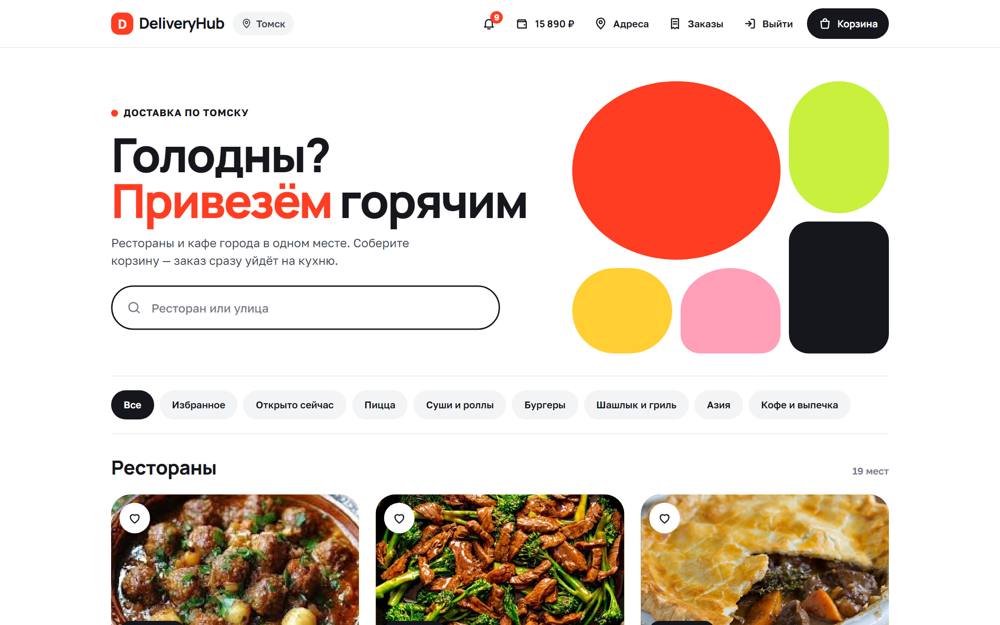
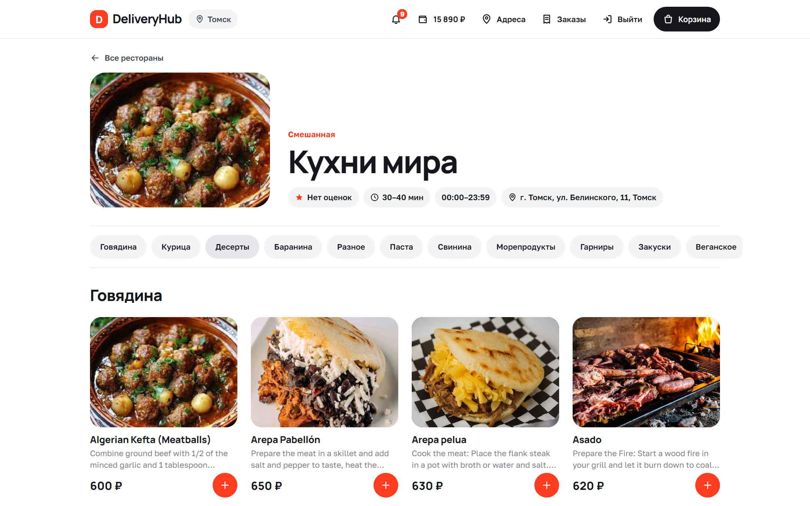
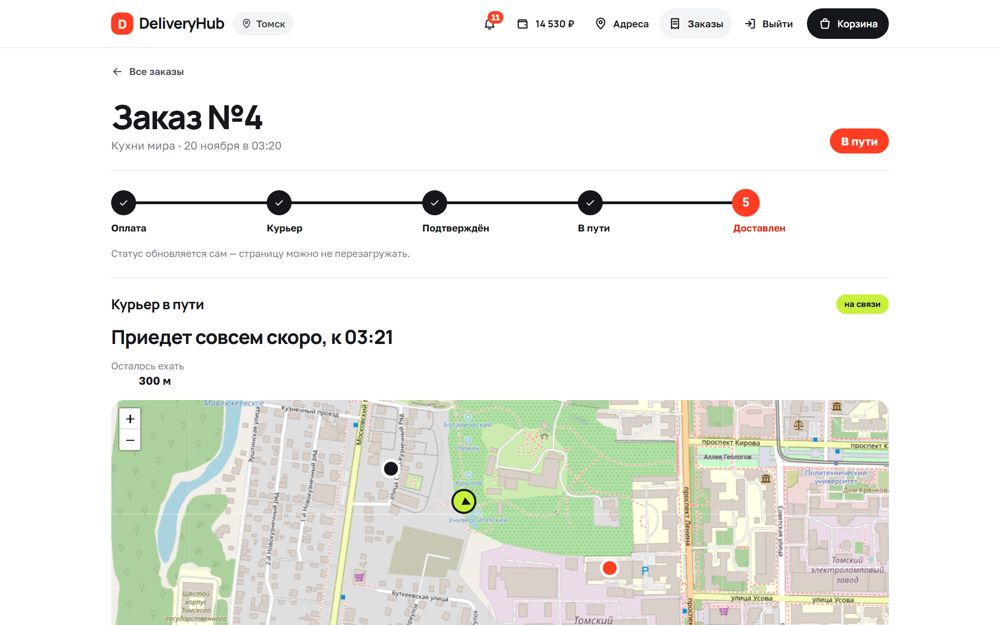
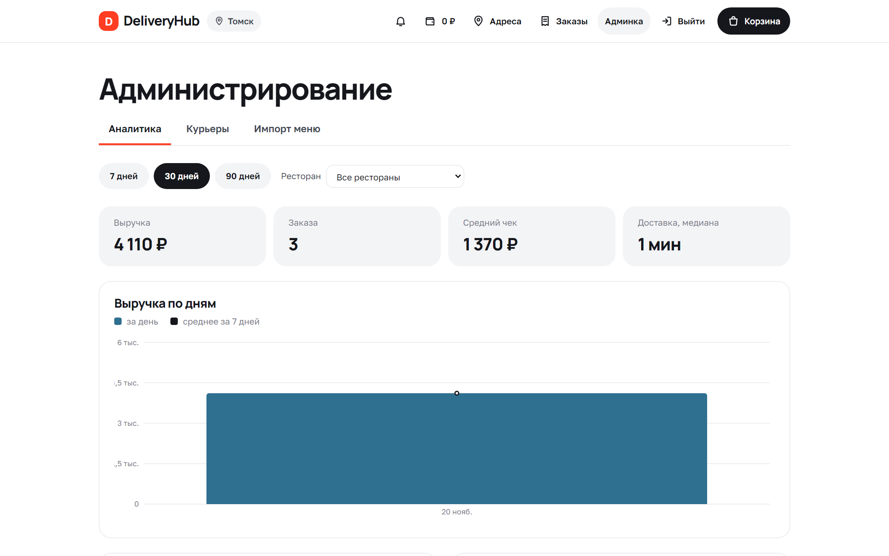
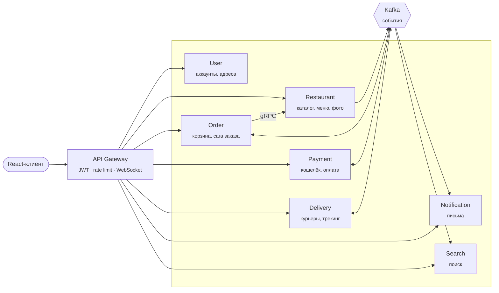

# DeliveryHub

<div align="center">


**Сервис доставки еды по Томску на микросервисах и событиях**

[Возможности](#возможности) · [Архитектура](#архитектура) · [Запуск](#быстрый-старт) · [Технологии](#технологии)

</div>

Я спроектировал и написал сервис доставки еды. Получилась довольно большая система
с событийной архитектурой: десять сервисов, у каждого своя база, общаются они через Kafka.

<table>
  <tr>
    <td></td>
    <td></td>
  </tr>
  <tr>
    <td></td>
    <td></td>
  </tr>
</table>

## Возможности

**Для покупателя**
- каталог ресторанов с фото, поиск на русском с подсказками, избранное
- корзина, промокоды, повтор прошлого заказа
- оплата из кошелька, автоматический возврат денег при отмене
- курьер на карте в реальном времени и время прибытия с учётом погоды
- уведомления на сайте и на почту, отзывы после доставки

**Для ресторана**
- кабинет: меню, фото блюд, стоп-лист, статусы заказов
- выручка по дням, топ блюд, время доставки

**Для администратора**
- импорт меню из TheMealDB и Open Food Facts
- управление курьерами и ролями, общая аналитика

**Под капотом**
- сага заказа с компенсациями: если шаг сорвался, предыдущие откатываются
- outbox и inbox — события не теряются и не обрабатываются дважды
- автоназначение ближайшего свободного курьера через PostGIS
- идемпотентные платежи по `Idempotency-Key`, rate limit на шлюзе

## Архитектура



## Быстрый старт

**Нужно:** Docker Desktop и Node.js 22+.

```bash
git clone https://github.com/nmaksimka/Delivery-Hub.git
cd Delivery-Hub
cp .env.example .env          # заполнить пароли и секреты
docker compose up -d --build  # бэкенд, базы, Kafka
cd frontend && npm ci && npm run dev
```

Сайт откроется на http://127.0.0.1:5173, меню загрузится само при первом старте.
Как заполнить `.env`, войти админом и сделать первый заказ — в [пошаговой инструкции](docs/getting-started.md).

| Адрес | Что там |
|---|---|
| http://127.0.0.1:5173 | сайт |
| http://localhost:3335/swagger-ui.html | документация API |
| http://localhost:8025 | письма о заказах |
| http://localhost:8086 | Kafka UI |
| http://localhost:3000 | Grafana |

## Тесты

```bash
./gradlew build            # unit, интеграционные (Testcontainers) и контрактные тесты
cd frontend && npm test    # тесты фронта
```

## CI/CD

| | |
|---|---|
| **Каждый push и PR** | сборка и все тесты бэкенда, lint, тесты и сборка фронта |
| **Тег `v*`** | Docker-образы всех сервисов публикуются в GitHub Container Registry |
| **Dependabot** | раз в неделю проверяет обновления Gradle, npm, Docker и GitHub Actions |
| **Ветка `main`** | защищена, попасть туда можно только через зелёный CI |

Для Kubernetes есть Helm-чарт в `helm/delivery-hub`, запуск в kind — в [docs/k8s.md](docs/k8s.md).

## Технологии

| | |
|---|---|
| **Backend** | Java 25 · Spring Boot 4 · Spring Cloud (Gateway, Eureka, Config) · JPA · Flyway · gRPC · Resilience4j |
| **Данные** | PostgreSQL + PostGIS · Redis · Elasticsearch · S3 (Garage) |
| **События** | Kafka (KRaft) · Avro + Schema Registry · outbox / inbox |
| **Безопасность** | JWT (RS256, JWKS) · ротация refresh-токенов · одноразовые тикеты для WebSocket |
| **Frontend** | React · TypeScript · Vite · Leaflet · STOMP |
| **Внешние API** | TheMealDB · Open Food Facts · Nominatim · OSRM · Open-Meteo |
| **Наблюдаемость** | Prometheus · Grafana · Loki |
| **Тесты** | JUnit 5 · Testcontainers · WireMock · Spring Cloud Contract · Vitest |
| **Инфраструктура** | Gradle · Docker Compose · GitHub Actions · Helm · kind |

## Структура

| Модуль | Что внутри |
|---|---|
| `apiGateway` | единая точка входа: маршруты, проверка токенов, WebSocket |
| `userService` | регистрация, JWT и refresh-токены, адреса, избранное |
| `restaurantService` | рестораны, меню, фото, импорт блюд |
| `orderService` | корзина, промокоды, заказы, сага, отзывы, аналитика |
| `paymentService` | кошелёк, холдирование и возвраты |
| `deliveryService` | курьеры, автоназначение по геопозиции, трекинг |
| `notificationService` | письма о статусах заказа |
| `searchService` | поиск по блюдам и ресторанам с подсказками |
| `discoveryServer` · `configServer` | Eureka и централизованные настройки |
| `apiContracts` | общие контракты событий (Avro) и gRPC |
| `frontend` | клиент на React |
| `helm` | чарт для Kubernetes |

## Как я работал с ИИ

Фронтенд, дизайн и схемы я делал вместе с Claude. Для бэкенда собрал себе окружение
из плагинов, MCP-серверов и скиллов: субагенты под ревью, тесты и разбор упавших сборок,
актуальная документация библиотек прямо в работе, LSP для Java. Отдельно учился работать
экономно — так, чтобы большой проект укладывался в лимиты токенов.

---

История версий — в [CHANGELOG](CHANGELOG.md).
